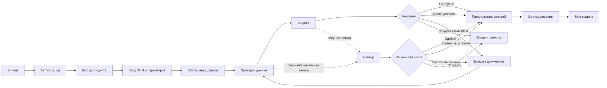

# День 2 — BPMN / процесс MVP

## Роли
- Клиент: создаёт/редактирует/отправляет заявку, загружает документы, принимает условия.
- Система: валидирует, обогащает, вызывает моки, считает скоринг, формирует решение.
- Моки: ЕГРЮЛ/ЕГРИП, прозрачность бизнеса, БКИ.
- Банкир: обрабатывает спорные заявки и принимает ручное решение.

## Ключевой принцип
Автоматический happy path не должен требовать участия банкира. Банкир подключается только при спорных правилах, недостатке данных или ручном override.
