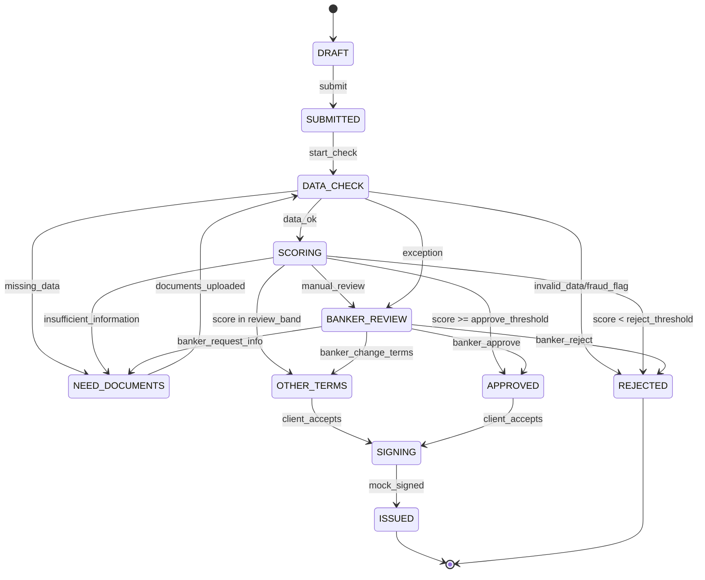

# День 2 — Диаграмма состояний заявки

## Канонические статусы API
- DRAFT
- SUBMITTED
- DATA_CHECK
- SCORING
- APPROVED
- OTHER_TERMS
- NEED_DOCUMENTS
- REJECTED
- SIGNING
- ISSUED
- BANKER_REVIEW

## Запреты переходов
- DRAFT → SCORING напрямую нельзя.
- REJECTED → APPROVED автоматически нельзя.
- ISSUED → любое другое состояние нельзя.
- Клиент не может менять решение напрямую.
- Банкир не должен вручную менять системные результаты без записи причины в audit log.
